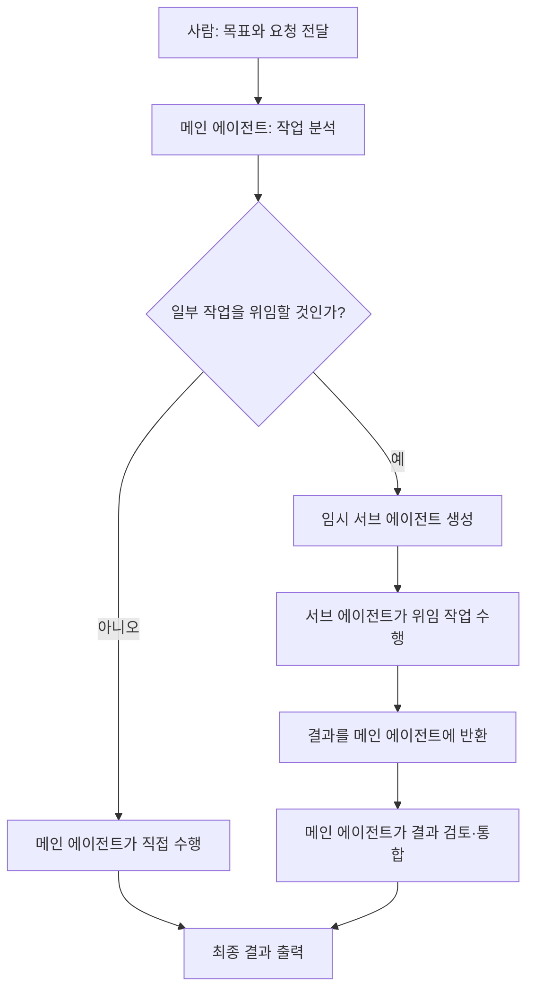
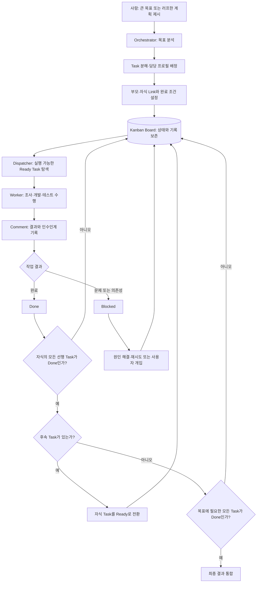

# Hermes Kanban Board 기반 멀티 에이전트 협업 구조

## 1. 문서 목적

이 문서는 연구실 구성원이 다음 내용을 쉽게 이해할 수 있도록 정리한 입문 자료이다.

- 기존 Hermes Delegate Task 방식의 작업 흐름
- Hermes Kanban Board 방식의 작업 흐름
- Board, Task, Link, Comment, Workspace, Dispatcher의 역할
- Delegate Task와 Kanban Board의 차이
- Hermes Kanban Board와 GitHub Projects의 차이
- 두 도구를 연구실 업무에 함께 활용하는 방법

> [!IMPORTANT]
> **Hermes Kanban Board와 GitHub Projects는 서로 다른 도구이다.**
> Hermes Kanban Board는 AI 에이전트의 실행과 인수인계를 관리하고, GitHub Projects는 연구실 구성원의 업무·일정·이슈 현황을 공유한다.

## 2. 한눈에 보는 핵심 차이

| 구분 | 기존 Delegate Task | Hermes Kanban Board | GitHub Projects |
|---|---|---|---|
| 주된 목적 | 메인 에이전트가 일부 작업을 임시 위임 | 여러 AI 에이전트의 작업 실행과 인수인계 관리 | 사람 중심의 프로젝트·일정·이슈 관리 |
| 작업의 중심 | 메인 에이전트와 현재 세션 | Board와 Task | Repository의 Issue·Pull Request와 Project View |
| 담당 주체 | 메인 에이전트와 임시 서브 에이전트 | Orchestrator와 역할별 Worker | 교수님과 연구실 구성원 |
| 상태 기록 | 메인 에이전트가 결과 회수 | Task 상태와 Comment에 보존 | Status, Assignee, Priority, Milestone 등에 보존 |
| 적합한 용도 | 짧고 명확한 작업 위임 | 장시간·다단계 AI 협업 | 연구실 전체 현황 공유와 위클리 회의 |

## 3. 기존 Delegate Task 방식

기존 Delegate Task 방식에서는 메인 에이전트가 전체 작업을 진행하다가 일부 작업을 임시 서브 에이전트에게 맡긴다. 서브 에이전트가 결과를 반환하면 메인 에이전트가 이를 이어받아 최종 결과물을 완성한다.

### 3.1 작업 흐름



### 3.2 특징과 한계

- 메인 에이전트가 작업 분배와 결과 통합을 책임진다.
- 서브 에이전트는 특정 작업을 위한 임시 실행 주체이다.
- 작업 맥락이 메인 에이전트와 현재 세션에 집중된다.
- 짧고 독립적인 조사나 검토 작업을 위임하기에 적합하다.
- 장기간 유지되는 역할, 작업 이력, 의존성 및 재시도 상태를 체계적으로 관리하기에는 불편할 수 있다.
- 병렬 실행 가능 여부와 범위는 사용하는 Hermes 버전과 실행 환경에 따라 달라질 수 있다.

## 4. Hermes Kanban Board 방식

Hermes Kanban Board 방식에서는 특정 에이전트가 아니라 **Board에 저장된 Task와 기록**이 작업의 중심이 된다. Orchestrator가 목표를 Task로 나누고, Dispatcher가 실행 가능한 작업을 찾아 Worker에게 전달한다. Worker는 결과와 인수인계 내용을 Task에 기록한다.

### 4.1 작업 흐름



### 4.2 프로필별 전문성

Worker 프로필은 역할에 필요한 메모리와 스킬을 갖도록 구성할 수 있다.

| 프로필 예시 | 주요 역할 |
|---|---|
| `researcher` | 자료 조사, 근거 수집 및 분석 |
| `developer` | 구현, 코드 수정 및 테스트 |
| `reviewer` | 결과 검토, 오류 탐색 및 품질 확인 |
| `writer` | 문서 작성, 시각자료와 최종 결과 정리 |

프로필 이름과 역할은 고정 규칙이 아니며 실제 팀 구성과 작업 목적에 맞게 정한다.

## 5. Kanban Board 핵심 구성요소

### 5.1 Board

Board는 모든 Task, 작업 관계, 상태, 담당 프로필 및 실행 기록을 관리하는 공간이다.

대표적인 상태는 다음과 같다. 실제 상태명은 Hermes 버전과 보드 설정에 따라 다를 수 있다.

| 상태 | 의미 |
|---|---|
| `Triage` | 아직 분류하거나 검토해야 하는 작업 |
| `Todo` | 수행해야 하지만 아직 실행 준비가 끝나지 않은 작업 |
| `Ready` | 조건을 충족하여 실행 가능한 작업 |
| `Running` | Worker가 수행 중인 작업 |
| `Blocked` | 문제, 승인 또는 의존성 때문에 중단된 작업 |
| `Done` | 완료 조건을 충족한 작업 |
| `Archived` | 실행 대상에서 제외하고 보관한 작업 |

### 5.2 Task

Task는 보드의 기본 작업 단위이다.

일반적으로 다음 정보를 포함한다.

- Task ID
- 제목과 작업 설명
- 담당 에이전트 프로필
- 현재 상태와 우선순위
- 부모·자식 관계
- Workspace
- Comment와 실행 기록
- 완료 조건

좋은 Task는 작업 내용뿐 아니라 **무엇이 확인되면 완료인지**까지 명확하게 적는다.

### 5.3 Link

Link는 Task 사이의 의존 관계를 나타낸다. 자식 Task는 연결된 모든 부모 Task가 `Done` 상태가 된 뒤에야 `Ready` 상태로 전환된다.

예시:

```text
요구사항 분석 → 기능 구현 → 테스트 → 최종 검토
```

단순한 관련성만으로 모든 Task를 연결하지 말고, 실제로 선행 작업의 결과가 필요한 경우에만 의존성을 설정한다.

### 5.4 Comment

Comment는 Worker 사이의 인수인계 기록이다. 다음 Worker가 이전 대화를 다시 읽지 않아도 이어서 작업할 수 있도록 작성한다.

권장 기록 항목:

- 수행한 작업과 현재 상태
- 생성하거나 수정한 파일의 위치
- 주요 판단과 결정 이유
- 실행한 테스트와 결과
- 발견한 문제와 남은 위험
- 다음 작업자가 해야 할 일
- 참고할 URL 또는 결과물

### 5.5 Workspace

Workspace는 Worker가 실제 파일과 코드를 다루는 작업 공간이다.

| 종류 | 용도 | 주의사항 |
|---|---|---|
| 임시/Scratch | 짧은 조사와 일회성 실험 | Task 완료 시 정리될 수 있으므로 최종 결과를 여기에만 두지 않는다. |
| 공유 Workspace | 여러 Worker가 같은 자료를 사용 | 동시 수정 규칙과 파일 담당 범위를 정한다. |
| 코딩 Workspace | Repository와 연결된 코드 작업 | Worktree 등을 사용해 동시 변경 충돌을 줄인다. |

최종 문서, 코드 또는 재사용할 자료는 영구 저장 위치에 옮기고 그 경로를 Comment에 기록한다.

### 5.6 Dispatcher

Dispatcher는 AI가 아니라 설정된 규칙을 실행하는 작업 관리 엔진이다.

주요 역할:

- 보드를 설정된 주기로 확인
- 실행 가능한 `Ready` Task 탐색
- Task를 담당 Worker에게 전달
- 완료된 부모 Task 확인
- 조건을 충족한 자식 Task를 `Ready`로 전환
- 실패한 작업의 재시도 횟수와 제한 관리
- 인증이나 사용자 판단이 필요한 작업 차단

확인 주기는 환경 설정에 따라 달라질 수 있으므로 특정 시간 간격을 고정값으로 가정하지 않는다.

## 6. 작업을 움직이는 세 가지 역할

| 역할 | 주체 | 책임 |
|---|---|---|
| Orchestrator | AI 에이전트 | 목표 분석, Task 분해, 의존성 설정, 프로필 배정, 결과 통합 |
| Worker | AI 에이전트 | 배정된 작업 수행, 결과 검증, Comment 기록, 완료 또는 Blocked 처리 |
| Dispatcher | 규칙 기반 실행 엔진 | 실행 가능한 작업 탐색, Worker 실행, 상태 전환과 재시도 관리 |

### Orchestrator

- 사용자의 목표와 완료 기준을 파악한다.
- 목표를 독립적으로 확인 가능한 Task로 나눈다.
- Task 사이의 선행·후속 관계를 설정한다.
- 작업에 맞는 전문 프로필을 배정한다.
- 진행 상황을 확인하고 최종 결과를 통합한다.

### Worker

- Task 설명과 완료 조건을 확인한다.
- 조사, 작성, 개발 또는 테스트를 수행한다.
- 과정과 결과를 Comment에 기록한다.
- 완료할 수 없으면 원인과 필요한 조치를 남기고 `Blocked` 처리한다.

### Dispatcher

- 보드 상태를 규칙에 따라 확인한다.
- 실행 조건을 충족한 Task를 Worker에게 전달한다.
- 부모 Task 완료 후 자식 Task의 실행 가능 여부를 갱신한다.
- 재시도·실행 제한·차단 조건을 적용한다.

## 7. Delegate Task와 Kanban Board 비교

| 구분 | Delegate Task | Hermes Kanban Board |
|---|---|---|
| 작업 중심 | 메인 에이전트와 현재 세션 | Board와 Task |
| 실행 주체 | 메인 에이전트와 임시 서브 에이전트 | 역할별 프로필 기반 Worker |
| 작업 기록 | 메인 에이전트가 결과를 회수 | Task, Comment와 상태에 지속 기록 |
| 병렬 작업 | 실행 환경과 호출 방식에 따라 제한적으로 활용 | 여러 독립 Task를 동시에 운영하기에 적합 |
| 중간 작업 추가 | 메인 에이전트가 계획을 다시 조정 | Board에 Task를 추가하고 관계를 설정 |
| 실패 복구 | 메인 에이전트가 다시 지시 | 상태와 기록을 바탕으로 재시도하거나 다른 Worker가 인계 |
| 의존성 관리 | 프롬프트 또는 메인 에이전트가 관리 | 부모·자식 Link로 명시 |
| 장기 협업 | 짧은 위임 작업에 적합 | 다단계·장시간 작업에 적합 |
| 인수인계 | 결과 반환 중심 | Comment와 결과물 위치 중심 |

두 방식은 경쟁 관계가 아니다. 짧고 독립적인 작업은 Delegate Task가 간단하고, 여러 단계와 역할이 필요한 작업은 Kanban Board가 적합하다.

## 8. Hermes Kanban Board와 GitHub Projects

두 도구는 모두 보드 형태를 사용하지만 관리 대상이 다르다.

| 항목 | Hermes Kanban Board | GitHub Projects |
|---|---|---|
| 관리 대상 | AI 에이전트가 실행하는 세부 작업 | 연구실 구성원의 프로젝트, 일정, Issue와 Pull Request |
| 주요 사용자 | Orchestrator, Worker, Dispatcher | 교수님과 연구실 구성원 |
| 세부 단위 | AI 실행 Task | GitHub Issue, Pull Request, Draft item |
| 핵심 기록 | 실행 상태, Comment, 인수인계, 결과물 | 담당자, 상태, 우선순위, Milestone, Repository |
| 적합한 목적 | AI 작업 자동 분해·실행·재시도 | 연구실 전체 현황 공유, 일정 관리, 위클리 회의 |

### 함께 사용하는 방법

1. GitHub Repository와 Issue에서 사람이 수행할 프로젝트 업무를 정의한다.
2. Milestone으로 같은 목표와 마감일을 가진 Issue를 묶는다.
3. GitHub Projects에서 담당자, 상태, 우선순위와 일정을 공유한다.
4. AI 작업이 필요한 Issue는 Hermes Kanban Board에서 세부 Task로 분해한다.
5. Worker가 조사·개발·테스트를 수행하고 결과를 Comment와 파일로 남긴다.
6. 검증된 결과를 Repository에 반영하고 GitHub Issue에 진행 상황을 기록한다.
7. 위클리 회의에서는 GitHub Projects를 기준으로 현재 상태와 다음 일정을 확인한다.

즉, 다음과 같이 역할을 나눌 수 있다.

```text
GitHub Projects: 무엇을 누가 언제까지 하는가
Hermes Kanban: 그 일을 AI 에이전트들이 어떻게 나누어 실행하는가
```

## 9. 운영 시 권장 규칙

- 모든 Task에는 담당 프로필과 완료 조건을 작성한다.
- 작업 결과는 Scratch에만 두지 않고 Repository 또는 공유 Workspace에 저장한다.
- Comment에는 결과물 위치와 테스트 결과를 반드시 남긴다.
- 실제 의존성이 없는 Task는 불필요하게 부모·자식으로 연결하지 않는다.
- 자동 재시도만으로 해결할 수 없는 인증, 권한, 비용 또는 의사결정 문제는 사용자에게 전달한다.
- GitHub Projects에는 AI의 모든 세부 실행 Task를 복사하지 않고, 사람이 확인해야 하는 업무와 결과만 반영한다.

## 10. 교수님께 확인할 사항

요구사항의 **“모든 프로젝트는 GitHub Repo를 생성하여 관리”**가 어느 운영 방식을 의미하는지 확인이 필요하다.

1. 모든 연구 과제를 `ains-lab/cag` 한 저장소의 폴더로 관리하는 방식
2. 과제 또는 프로젝트마다 별도의 GitHub Repository를 생성하는 방식

확인 질문 예시:

> “모든 프로젝트는 GitHub Repo를 생성하여 관리”라는 요구사항이 각 연구 과제마다 별도의 Repository를 생성한다는 의미인지, 아니면 `ains-lab/cag` 저장소 안에서 프로젝트별 폴더를 만들어 관리한다는 의미인지 확인 부탁드립니다.

이 사항이 확정되기 전에는 특정 방식을 연구실 표준으로 단정하지 않는다.

## 11. 핵심 정리

1. Delegate Task는 메인 에이전트가 임시 서브 에이전트에게 일부 작업을 맡기는 방식이다.
2. Hermes Kanban Board는 Board와 Task를 중심으로 여러 Worker의 실행 상태와 인수인계를 관리한다.
3. Orchestrator는 작업을 설계하고, Worker는 실행하며, Dispatcher는 규칙에 따라 실행과 상태 전환을 관리한다.
4. Hermes Kanban Board는 AI 작업 실행용이고, GitHub Projects는 사람 중심의 연구실 업무·일정 관리용이다.
5. 연구실에서는 GitHub Projects로 전체 현황을 공유하고, 필요한 업무만 Hermes Kanban Board로 세분화해 AI에게 실행시키는 방식이 적합하다.

> [!NOTE]
> Hermes의 상태명, Workspace 수명, Dispatcher 확인 주기와 재시도 규칙은 설치 버전 및 설정에 따라 달라질 수 있다. 실제 운영 전 현재 서버 설정을 기준으로 확인한다.
